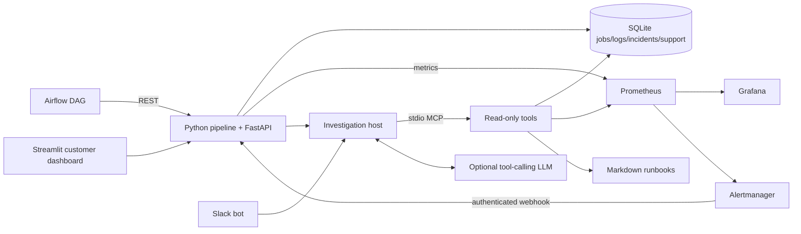

# PlatformCare

Data-platform observability and AI-assisted incident investigation using Python, MCP, Slack, Airflow, Prometheus, and Grafana.

**Status:** stages 1 and 2 verified together with browser checks and 16 passing tests. Stage 3 completed three live Groq/MCP smoke scenarios and five passing targeted agent regression tests. Slack health/help/feedback worked in a real workspace, with 12 local handler tests. Stage 5 passed nine native Prometheus/Alertmanager/Grafana integration checks. Stage 6 executed a real Airflow DAG through healthy, failed and recovered runs. Automatic Slack incident notifications and continuous scheduler/container operation remain unverified. Consult `VERIFICATION.md` for exact runtime evidence and limits.

## What an engineer sees

The usage analytics pipeline publishes aggregates from synthetic service events. A controlled input/dependency/latency fault produces job evidence and an incident. The dashboard answers: Is my data ready? What failed? Who owns it? What should I try? The support agent inspects bounded read-only MCP tools and retrieves cited troubleshooting runbooks. Slack offers the same health and support workflow inside a test workspace.



## Cost

The Python application, Streamlit, MCP SDK, Airflow, Prometheus, and Grafana can run locally without a hosted subscription. Local software still uses your machine's resources. Check the license applicable to your Docker Desktop use. A Slack basic developer sandbox is available through the Slack Developer Program without an additional cost. Hosted model APIs charge according to provider usage. A compatible local model avoids hosted API charges, subject to your machine's capacity and the model's license.

Default `MODEL_MODE=offline` makes **no LLM calls**. It deterministically exercises real MCP discovery and tool calls. It is a test/replay mode, not AI inference. Use live mode and verify its outputs before listing a functioning LLM integration on your resume.

## Fast local start

Use Python 3.12+ for the app. Airflow has its own container/runtime.

```bash
python3 -m venv .venv
source .venv/bin/activate
pip install -r requirements.txt
cp .env.example .env
python -m platformcare.pipeline healthy
python -m platformcare.pipeline invalid_input
uvicorn platformcare.api:app --host 127.0.0.1 --port 8000
```

In a second terminal, activate the environment and run:

```bash
streamlit run dashboard.py --browser.gatherUsageStats=false
```

Open the dashboard at http://localhost:8501 and API docs at http://localhost:8000/docs. Use `X-Platform-Token` from `.env` for protected API routes. The sample token is intended for the loopback-only lab. No secrets belong in Git.

## Full container environment

For a temporary native monitoring test without a Docker VM, see [Stage 5 monitoring](docs/STAGE5_MONITORING.md). It verifies Prometheus/Grafana/Alertmanager separately from Airflow.

For actual one-off Airflow DAG execution without a persistent scheduler/UI, see [Stage 6 Airflow](docs/STAGE6_AIRFLOW.md).

Start Docker Desktop. The Airflow image is large; allow disk, RAM, and download time. Stop any host API/dashboard using ports 8000/8501 before running the stack.

```bash
cp .env.example .env
docker compose up -d --build
docker compose ps
```

Services: dashboard 8501, API 8000, Prometheus 9090, Alertmanager 9093, Grafana 3001, Airflow 8080; published ports bind to loopback.

- Grafana has a provisioned Prometheus datasource and customer health/support dashboard. Anonymous access is view-only; local admin username is `admin`, default password `platformcare-local-demo`.
- Airflow standalone is a development deployment. Retrieve its generated login password locally from `/opt/airflow/simple_auth_manager_passwords.json.generated` inside the container; do not commit or share it.
- Enable `usage_analytics` in Airflow. Trigger with JSON configuration `{"scenario":"invalid_input"}` to record a failed DAG task, or `{"scenario":"healthy"}` for recovery. Run evidence records `source=airflow`.
- For the failure alert, leave the failed latest job in place for at least 30 seconds. Expect Prometheus rule evaluation and Alertmanager grouping delays before the webhook incident arrives.
- Pipeline incidents and monitoring alerts have distinct identities and origins. They can both describe one failure; deduplication operates within each origin/fingerprint.
- If changing `PLATFORM_TOKEN`, also change Alertmanager's authorization credential in `infra/alertmanager.yml`.
- The API-down alert cannot reach its API receiver while the API is down. This lab deliberately demonstrates the limitation; it is not an independent paging service. Add an external receiver for production use.

## Slack setup (no paid Slack workflow feature needed)

See [Stage 4 walkthrough](docs/STAGE4_SLACK_SETUP.md) for workspace creation, the two token types, and hidden terminal entry using `python3 scripts/configure_slack.py`. The local handler suite has 12 passing tests; health commands, live investigation replies, and Helpful feedback were also verified in a test workspace. Automatic incident notifications remain unverified.

1. Create a test workspace or developer sandbox. Create an app from `slack-manifest.json`.
2. Install it into your workspace. Save the bot OAuth token in `.env` as `SLACK_BOT_TOKEN`.
3. Create an app-level token with `connections:write`, saved as `SLACK_APP_TOKEN`.
4. Invite the bot to a test channel. Optionally set its channel ID as `SLACK_ALERT_CHANNEL` to deliver incident messages and threaded resolutions.
5. With the local app database, run `python -m platformcare.slack_bot`. With the container database, use `docker compose --profile slack up -d slack` instead. Do not run both pollers against the same database.
6. Test `/platform-health`, `/platform-help Why did the pipeline fail?`, and `/incident-summary <id>`.

Commands acknowledge before investigation. Support requests are deduplicated using Slack trigger IDs. Health replies are ephemeral; investigations are posted to the invoking channel. Use only your test channel and synthetic data. No Slack message was sent during credential-free development.

Socket Mode avoids a public inbound endpoint. The project separately demonstrates real HTTP webhooks through Alertmanager. Optional Slack HTTP mode: set `SLACK_TRANSPORT=http` and `SLACK_SIGNING_SECRET`, configure a public HTTPS forwarding endpoint to port 3000 `/slack/events`, and update Slack command/interaction URLs. Bolt handles signature verification. This optional transport requires separate testing.

The Slack incident poller retries failed posts. Normal poll cycles do not repeat persisted incident posts, but a process crash after Slack accepts a post and before SQLite commits its timestamp can cause a duplicate. This is not an exactly-once delivery claim.

## Live model configuration

For a hosted free-plan starting point that avoids local model downloads, see [Stage 3 setup](docs/STAGE3_SETUP.md).

Set `.env` and restart the API/bot:

```dotenv
MODEL_MODE=live
MODEL_BASE_URL=http://localhost:11434/v1
MODEL_NAME=your-installed-tool-capable-model
MODEL_API_KEY=local
```

The endpoint must support OpenAI-compatible `/chat/completions` function tool calling. For a hosted provider, use its documented base URL, model ID, and key; no particular model is assumed. In Docker, a model running on the host typically needs `host.docker.internal` instead of localhost. Do not send real operational logs to an unapproved endpoint.

The live model chooses tools through a bounded investigation loop; every execution goes through the MCP client. The host limits calls, bounds log output, allowlists metrics, rejects invented runbook paths, and escalates invalid final output. Source-path validation does not guarantee factual prose: evaluate summaries against tool evidence. There is no autonomous repair.

## Verify and evaluate

```bash
python -m pytest -q
python -m scripts.evaluate
python -m platformcare.agent
```

Offline evaluation writes `output/evaluation-offline.json`, labeled as MCP integration evidence rather than model accuracy. Tests use separate temporary databases. Before claiming live-agent performance, run the same scenarios in live mode, inspect tool traces, assess supported claims and appropriate escalation, and record failures as well as successes.

Metrics distinguish failed runs, data freshness, and API availability. `platform_has_success=0` means no successful output; freshness=0 alone must not be interpreted as healthy. Incident resolution time includes only resolved incidents. Support request latency measures response recording; it is not a human customer-success or production MTTR metric. Feedback fractions include their sample count. Lexical runbook retrieval is intentionally simple and inspectable.

## Portfolio demo

1. Show the synthetic workload, owner, consumer, and freshness objective.
2. Run healthy, then invalid input. Show the failed job, logs, and customer impact.
3. Show Prometheus/Grafana and the alert webhook when the stack is running.
4. Ask Slack or the dashboard to investigate; show MCP tool traces and cited runbook.
5. Run healthy; show incident resolution and restored freshness.
6. Show feedback and support metrics; explain the demo's limits.

Keep a short narrated video, screenshots, architecture explanation, and actual evaluation results. Ask a peer to try it and document feedback only after receiving it. See `docs/DEMO.md` and `VERIFICATION.md`.

## References

- Slack Socket Mode: https://docs.slack.dev/tools/bolt-python/concepts/socket-mode/
- Slack developer sandbox: https://docs.slack.dev/tools/developer-sandboxes/
- MCP Python v1 maintenance SDK: https://github.com/modelcontextprotocol/python-sdk/tree/v1.x
- Prometheus alerting: https://prometheus.io/docs/alerting/latest/overview/
- Airflow local development: https://airflow.apache.org/docs/apache-airflow/stable/start.html
- OpenAI-compatible request shape reference: https://developers.openai.com/api/reference/resources/chat/subresources/completions/methods/create
